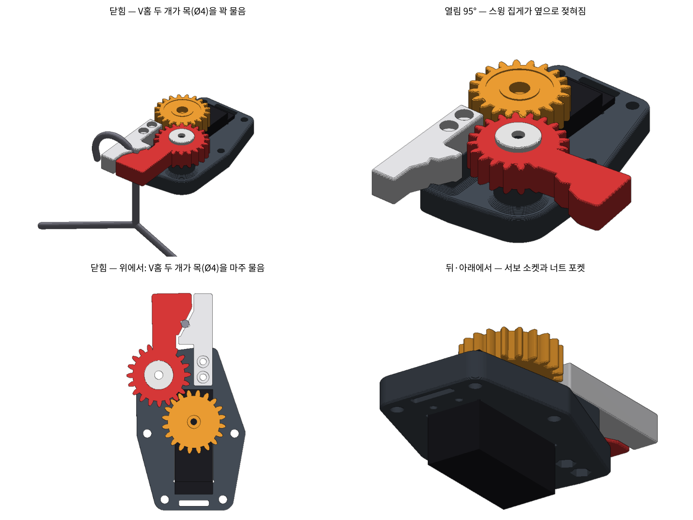

# 그리퍼 (스윙 집게 그리퍼 v3)

옷걸이 목 부분을 잡아 이송하고 거는 동작에 쓰는 그리퍼이다. 서보 모터 1개가 기어로 스윙 집게를 돌려 고정 집게와 함께 옷걸이 목(Ø4)을 물고 푼다. 이 폴더에는 3D 모델 파일, 렌더링 이미지, 서보 동작 테스트 코드가 있다.

이 구조와 코드는 테스트용 초기 버전이다. 파지 시험 결과에 따라 형상과 코드를 수정해서 사용한다.

## 파일

| 파일               | 내용                                                                                           |
| ------------------ | ---------------------------------------------------------------------------------------------- |
| `Gripper_v3.3mf`   | 그리퍼 3D 모델 (파츠 5개, 단위 mm). 3MF를 열 수 있는 슬라이서나 3D 프로그램으로 열어 출력한다. |
| `render_img.png`   | 닫힘·열림 상태와 위·아래 방향 렌더링 이미지                                                    |
| `gripper_test.ino` | 서보 각도를 시리얼로 입력해 움직이는 테스트 코드 (Arduino Servo 라이브러리)                    |

## 렌더링



| 위치        | 상태                 | 설명                                 |
| ----------- | -------------------- | ------------------------------------ |
| 왼쪽 위     | 닫힘                 | V홈 두 개가 옷걸이 목(Ø4)을 꽉 문다. |
| 오른쪽 위   | 열림 95°             | 스윙 집게가 옆으로 젖혀진다.         |
| 왼쪽 아래   | 닫힘, 위에서 본 모습 | V홈 두 개가 목(Ø4)을 마주 문다.      |
| 오른쪽 아래 | 뒤·아래에서 본 모습  | 서보 소켓과 너트 포켓이 보인다.      |

## 구조

서보 기어(주황)가 스윙 집게(빨강)의 기어와 맞물려 스윙 집게를 회전시키고, 고정 집게(흰색)는 움직이지 않는다. 닫을 때 스윙 집게와 고정 집게의 V홈이 옷걸이 목 양쪽을 문다.

| 파츠         | 렌더 색   | 역할                                          | 크기 (mm)          |
| ------------ | --------- | --------------------------------------------- | ------------------ |
| `Frame`      | 짙은 회색 | 서보 소켓, 너트 포켓, 고정용 구멍이 있는 몸체 | 56.1 × 83.5 × 32.6 |
| `Swing_Jaw`  | 빨강      | 기어가 붙은 회전 집게                         | 34.1 × 58.4 × 10   |
| `Fixed_Jaw`  | 흰색      | 몸체에 고정된 집게                            | 17.5 × 47.4 × 10   |
| `Servo_Gear` | 주황      | 서보 축에 끼우는 구동 기어                    | Ø33 × 10           |
| `Washer`     | 흰색      | 스윙 집게 회전축 위 와셔                      | Ø15 × 2            |

- 크기는 3MF 파일의 각 파츠 메쉬에서 잰 최대 치수이다.
- 3MF에서 파츠는 서로 떨어진 위치에 놓여 있다. 조립한 모습은 렌더링 이미지를 참고한다.
- 서보 각도와 집게 각도의 관계는 기어비에 따라 달라진다. 실제 측정 후 아래 측정 기록에 적는다.

## 테스트 코드

`gripper_test.c`는 서보를 시리얼 입력 각도로 움직인다. 그리퍼 구조 시험에는 MG996R 서보를 쓴다.

### 동작

- 서보 신호선은 9번 핀에 연결한다.
- 펄스 폭은 600~2400 µs로 제한해 서보가 한계를 넘어 돌지 않게 한다.
- 시작하면 서보를 45°로 이동하고 `=== 부팅됨 ===`을 출력한다.
- 시리얼 통신 속도는 115200이다.
- 0~180 사이 정수를 입력하고 Enter를 누르면 그 각도로 이동하고 `이동: 각도`를 출력한다. 범위를 벗어난 값은 무시한다.

### 준비

1. Arduino 계열 보드에 서보 신호선을 9번 핀, GND를 보드 GND에 연결한다.
2. 서보 전원은 보드 5V 핀 대신 별도 전원으로 공급하고, 전원 GND를 보드 GND와 공통으로 묶는다. 부하가 걸리면 보드 전원으로는 전류가 부족할 수 있다.
3. Arduino IDE에서 코드를 열어 보드에 업로드한다. 파일 확장자가 `.c`라서 IDE에서 바로 열리지 않으면 `.ino`로 바꾸고, 같은 이름의 폴더에 넣어 사용한다.
4. 시리얼 모니터를 열어 속도를 115200, 줄 끝 설정을 새 줄로 맞춘다.

### 사용

```
45     ← 입력 후 Enter
이동: 45
```

그리퍼를 닫은 각도와 연 각도를 찾을 때는 값을 5~10°씩 바꿔 가며 입력하고, 집게가 옷걸이 목을 문 각도와 완전히 열린 각도를 기록한다.

## 주의 사항

- 처음에는 옷걸이 없이 가까운 각도로 천천히 움직여 집게가 프레임이나 서로 부딪히지 않는 범위를 확인한다.
- 집게가 막힌 상태에서 서보를 계속 밀면 서보가 과열되거나 파츠가 부러질 수 있다. 막히면 바로 각도를 되돌린다.
- 3D 프린트 파츠는 출력 방향과 설정에 따라 기어 이와 홈 치수가 달라진다. 맞물림이 뻑뻑하면 파츠를 다시 출력하거나 수정한다.

## 측정 기록

```
상태 | 서보 각도(°) | 집게 각도(°) | 비고
닫힘 (옷걸이 목 물림) |  |  |
완전 열림 |  |  | 렌더링 기준 95°
```

현재 테스트 시, 0도와 95도로 제어. (외부 전원을 사용하지 않고 아두이노 5v를 인가하여 문제가 생기는 것으로 파악됨. 이후 개선 필요.)

## 테스트 목록

완료한 항목은 `[ ]`를 `[x]`로 바꿔 진행 상황을 표시한다.

- [x] 1. 동작 확인: 0~180° 중 안전한 범위에서 서보가 부드럽게 움직이는지 확인
- [ ] 2. 각도 측정: 닫힘 각도와 열림 각도를 찾아 위 표에 기록
- [x] 3. 빈 옷걸이 파지: 옷걸이 목(Ø4)을 문 채 들어 올려 흔들었을 때 빠지지 않는지 확인
- [x] 4. 반팔 파지: 반팔 옷을 건 옷걸이를 잡고 이동해도 낙하·미끄러짐이 없는지 확인 (회의 10.13 기준: 반팔 의류 대상)
- [ ] 5. 접촉면 개선: V홈 접촉면에 고무패드를 붙였을 때 미끄러짐이 줄어드는지 확인
- [ ] 6. 열림 동작: 옷걸이를 놓을 때 스윙 집게가 옷이나 행거 봉에 걸리지 않는지 확인
- [ ] 7. 반복 시험: 닫고 열기를 반복해 파츠 마모, 서보 발열 확인
