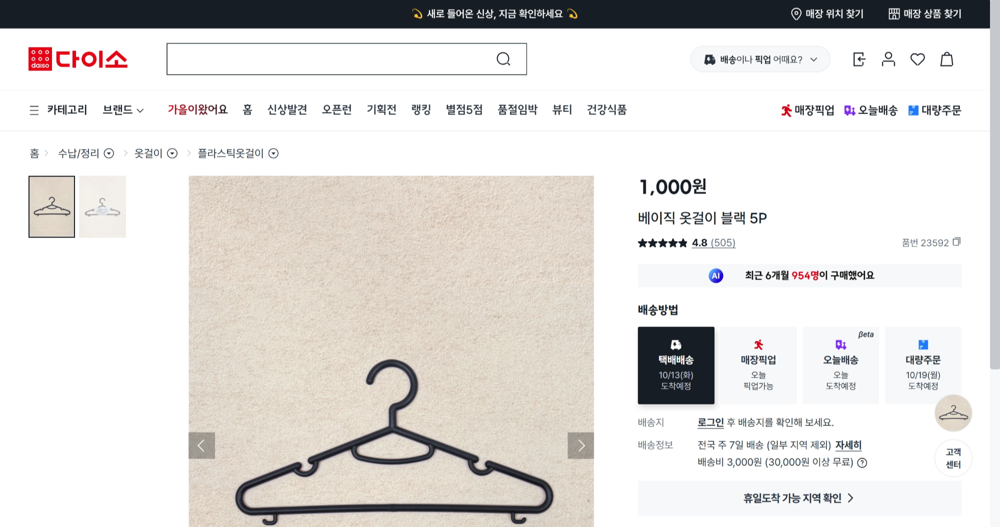
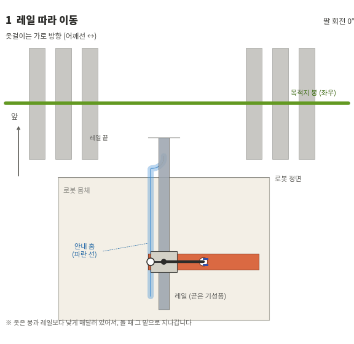
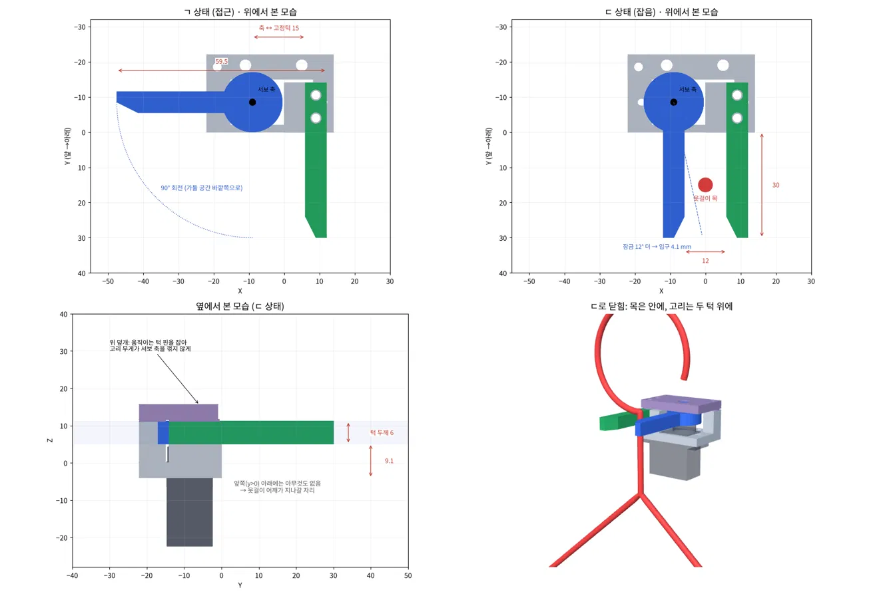
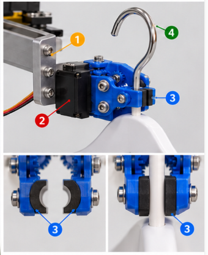
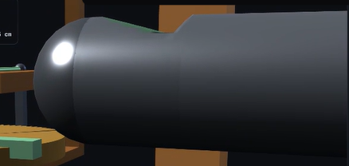
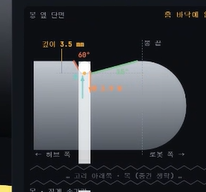
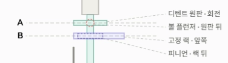

# 6주차 행거·그리퍼 구조 선정 및 실험 계획

| 항목 | 내용 |
| --- | --- |
| **회의 일시** | 2026년 10월 10일(토) 14:00 ~ 16:00 |
| **회의 장소** | 오프라인 |
| **참석자** | 박상원, 곽민지, 김민서 유지원, 윤대준 |

- **회의 목표:**
  - 직전 회의에서 검토한 거치 홈·회전·옷걸이를 잡는 구조 구체화
  - 개인별 준비 자료와 그리퍼 모델 비교
  - 우선 제작할 행거·회전 구조 및 테스트 모델 선정
  - 제작 전 부품 조사와 기능 실험 계획 정리

- **다음 회의까지 할 일:**
  - 변형이 적고 하부 받침을 넣을 공간이 있는 기성 옷걸이 확인
  - PincOpen STL 부품 구성과 모터 결합 규격 확인 후 출력 준비
  - STS3215 제어 보드·전원·케이블과 구매 구성 조사
  - 바퀴 달린 원형 행거 조사 및 거치 홈·방사형 지지대 치수 검토
  - 레일 지지부, 행거 상부 회전 및 하부 고정 방식 구체화
  - 옷걸이 잡기·90° 회전·홈 인출 실험 조건 정리

- **다음 회의 목표:**
  - 실물 옷걸이와 그리퍼의 결합 가능성 확인
  - 출력·부품 조사 결과를 바탕으로 팁과 모터 구성 구체화
  - 인출·이송·재진열 시 간섭 및 고정 문제 검토
  - 본체·행거 치수와 제작 순서 정리

---

## 1. 직전 회의에서 이어진 과제

[직전 회의록: 10월 6일·8일](2026-10-06_10-08.md)

지난 회의에서는 이송 동작을 단순화하는 방향으로 **거치 홈, 그리퍼 회전, 옷걸이를 잡는 구조**를 나누어 검토했다.

**기존 구조에서 해결하려는 문제**

1. 도킹·인출 중 그리퍼가 행거와 부딪히는 문제
2. 옷걸이가 홈의 단차를 넘을 때 그리퍼에 상향 힘이 전달되는 문제
3. 회전·이송 중 옷걸이가 미끄러지거나 자세가 변하는 문제

**직전 기준 구조**

| 시뮬레이터 | 실행 | 파일 |
| --- | --- | --- |
| PRADA U Bay Slide | [실행](https://raw.githack.com/SSangWonPark/Capstone_Design/main/docs/meetings/assets/2026-10-10/previous-u-bay-slide.html) | [previous-u-bay-slide.html](assets/2026-10-10/previous-u-bay-slide.html) |

---

## 2. 셀렉된 아이디어

### 2-1. 우선 적용할 그리퍼 회전 구조

| 시뮬레이터 | 실행 | 파일 |
| --- | --- | --- |
| 우선 적용할 그리퍼 회전 구조 | [실행](https://raw.githack.com/SSangWonPark/Capstone_Design/main/docs/meetings/assets/2026-10-10/prada-prototype-v17.html) | [prada-prototype-v17.html](assets/2026-10-10/prada-prototype-v17.html) |

- 레일의 직선 이동과 기어가 맞물리는 회전 구간을 보여준다.
- 거치 홈·받침 턱과 판 연동 구상을 설명한다.
- 판 형상과 상세 기구는 수정 중이다.

### 2-2. 원형 거치 홈 — 단차와 인출 여유

| 시뮬레이터 | 실행 | 파일 |
| --- | --- | --- |
| 원형 거치 홈 | [실행](https://raw.githack.com/SSangWonPark/Capstone_Design/main/docs/meetings/assets/2026-10-10/circular-groove-demo.html) | [circular-groove-demo.html](assets/2026-10-10/circular-groove-demo.html) |

- 홈에서 옷걸이가 빠질 때의 높이 단차와 상하 여유를 보여준다.
- 실제 홈 폭과 라운드는 옷걸이 규격에 맞춰 조정해야 한다.

### 2-3. 랙-피니언·디텐트 회전 구조

| 시뮬레이터 | 실행 | 파일 |
| --- | --- | --- |
| 랙-피니언·디텐트 | [실행](https://raw.githack.com/SSangWonPark/Capstone_Design/main/docs/meetings/assets/2026-10-10/wrist-rack-detent.html) | [wrist-rack-detent.html](assets/2026-10-10/wrist-rack-detent.html) |

### 2-4. PincOpen — 출력할 테스트 모델

| 자료 | 링크 | 활용 |
| --- | --- | --- |
| 공개 모델 동작 영상 | [영상](https://www.youtube.com/shorts/5o2Au9_xjNQ) | 구동 형태와 팁 교체 가능성 참고 |
| 원본 저장소 | [PincOpen](https://github.com/pollen-robotics/PincOpen) | STL·부품 구성 확인 |
| 동작 테스트 코드 | [flash_test.ipynb](https://github.com/pollen-robotics/PincOpen/blob/main/flash_and_tests/flash_test.ipynb) | 제어 방식 참고 |

---

## 3. 이번 회의에서 선정한 구조

| 항목 | 선정 내용 | 이유 및 후속 확인 |
| --- | --- | --- |
| **옷걸이** | 걸쇠·하부 받침을 넣을 공간이 있고 변형이 적은 기성 옷걸이 | 실물 규격 확인 후 그리퍼 팁 설계. 다이소 플라스틱 제품 후보 조사 |
| **그리퍼 형태** | **좌우 집게와 아래 받침으로 3개 위치 지지 끝단 고무 패킹** | 마찰력만으로 지지하는 부담을 줄이고 낙하·회전 방지 |
| **그리퍼 회전** | **축 고정 형식과 레일·기어 연동 구조 우선 적용** | 이송 중 기어 맞물림으로 회전. 상세 설계는 추가 구체화 |
| **행거 형태** | 지지대 길이가 같은 태양 형태 원형 | 옷걸이를 비슷한 거리에서 인출하도록 구성 |
| **행거 틀** | 바퀴 달린 기성 원형 행거 조사 | 상부 연결·회전 구동부와 하부 잠금은 실물 확인 후 설계 |
| **그리퍼 테스트 모델** | **PincOpen 우선 출력** | 옷걸이를 잡을 수 있는지 확인 후 옷걸이에 맞춰 팁 수정 |
| **테스트 모터** | **Feetech STS3215 후보 조사 보유 모터 활용 가능성 확인** | 모터 축·장착부·제어 보드·전원·케이블 확인 후 구매 판단 |

### 선정 구조 설명

행거는 **지지대 길이가 같은 태양 형태 원형**으로 정했습니다. 옷걸이가 항상 비슷한 거리에서 인출되도록 하기 위한 선택입니다.

그리퍼 회전은 **축을 고정하고 레일 이동과 기어 맞물림을 이용하는 구조**를 우선 구체화할 예정입니다.

옷걸이를 잡는 부분은 **좌우에서 잡고 아래에서 받치는 형태**로, 마찰력만으로 옷을 버티는 부담을 줄이려 합니다.

**PincOpen을 먼저 출력**해 옷걸이가 잘 잡히는지 확인하고, 실제 옷걸이에 맞춰 끝단 팁을 수정할 계획입니다.

모터 제어 구성과 행거 고정 구조는 실물 규격을 확인하면서 구체화할 예정입니다.

---

## 4. 앞으로 검증할 기능

| 기능 | 확인할 내용 |
| --- | --- |
| **반팔 조건 옷걸이 잡기** | 옷걸이와 반팔을 잡은 상태의 낙하·미끄러짐·팁 처짐 |
| **90° 회전** | 회전 중 옷걸이 이탈과 자세 변화 |
| **홈 인출** | 단차 통과, 그리퍼·행거 간섭, 상하 여유 |
| **위치 오차 옷걸이 잡기** | 정렬 오차를 줬을 때 옷걸이를 잡고 유지하는 안정성과 카메라 필요성 |
| **그리퍼 무게·전력** | 그리퍼 자체 무게와 동작 시 전력 소모 |
| **행거 고정** | 편중 적재와 인출·이송 시 흔들림·위치 이동 |

- 초기 계산에서는 옷걸이 최대 100 g, 반팔 최대 300 g을 가정했다. 실험에서는 실제 질량을 기록한다.
- 반복 횟수와 수치 합격 기준은 실험 전에 정한다.
- 현재까지는 구조 선정과 테스트 모델 검토 단계이며, 위 기능은 후속 실험 계획이다.

---

## 5. 주요 논의

### 5-1. 태양 형태 원형 행거

- 동일 길이 지지대를 중심에서 방사형으로 배치하는 형태로 정했다.
- 나선형처럼 지지대 길이가 달라지면 옷걸이마다 접근·인출 거리가 달라질 수 있다는 점을 고려했다.
- 바퀴가 달린 기성 원형 행거를 조사하고 지지대·홈을 추가하는 방향을 검토했다.
- 상부 연결과 회전 모터 위치는 행거를 주문하고 실물을 확인한 뒤 정한다.
- 원형 행거의 무게중심과 편중 하중을 검토한다.
- 하부 잠금 구조는 구현이 어려운 부분으로, 본체 무게·치수를 확인한 뒤 구체화한다.

### 5-2. 옷걸이 거치 홈과 인출

- 옷걸이를 일정 위치에 걸고 쉽게 뺄 수 있도록 홈을 적용하는 데 의견이 모였다.
- 홈의 라운드·폭·각도와 상하 여유를 실물에 맞춰 조정한다.
- 단차를 넘을 때 옷걸이를 꽉 잡으면 그리퍼까지 위로 밀릴 수 있어, 받침 구조와 인출 중 여유를 함께 검토했다.
- 홈 외의 위치에 옷걸이를 걸지 못하도록 형상을 바꾸는 방안도 제안됐다.
- 원형 홈 HTML 일부에는 목적지 행거와의 간섭이 남아 있어 추가 수정이 필요하다.

### 5-3. 그리퍼 회전 구조 비교

| 제안자 | 방식 | 논의 결과 |
| --- | --- | --- |
| 곽민지 | 회전을 유도하는 홈·롤러를 따라 이동하며 회전 | 홈이 꺾이는 부분, 베어링 지지, 하중과 배선 검토 |
| 윤대준 | 레일 이동과 기어 맞물림을 이용한 회전 판 연동 | **우선 구체화할 구조로 선정**. 판 형상은 추가 수정 |
| 김민서 | 랙-피니언 회전과 디텐트로 0°·90° 자세 유지 | 비교 제안. 최종 적용 여부 미정 |

- 윤대준의 구조를 먼저 구체화하고 구현이 어려우면 다른 안을 다시 검토하기로 했다.
- 디텐트 유지력이 부족한 경우 솔레노이드 래치를 이용하는 대안이 언급됐으나 채택은 확정하지 않았다.

### 5-4. 옷걸이를 잡는 구조와 PincOpen

- 목 부분을 좌우에서 잡고 아래에서 받치는 3점 지지 방향으로 정리했다.
- 그리퍼 집게와 3D 어댑터를 결합해, 어댑터가 옷걸이 걸쇠의 밑면 홈에 끼워지도록 하여 안정성을 높이는 방안을 검토했다.
- 옷걸이 옆 부분을 잡으므로 마찰력을 높이기 위해 끝단에 오돌토돌한 고무 패킹을 적용한다.
- 다양한 그리퍼 구조 중 옷걸이 형태에 맞고 잡기 쉬운 형태를 실제로 제작해 실험한다.
- 그리퍼 자체 무게와 전력 소모도 함께 확인한다.
- 실제 옷걸이를 정한 뒤 팁과 받침 형상을 맞춘다.
- PincOpen을 우선 출력해 옷걸이가 잘 잡히는지 확인하고 필요하면 끝단 팁을 수정한다.
- 보유 모터를 사용하거나 크기를 수정할 경우, 모터 결합부와 기어 맞물림을 확인한다.

### 5-5. 모터·제어 구성 및 재료

- STS3215의 제어 보드·전원·케이블과 판매 구성을 추가 조사하기로 했다.
- 그리퍼를 레일 위에서 이동시키는 방법으로, DC 모터가 톱니바퀴를 돌려 이동시키는 방식도 검토했다.
- 철제는 가공이 어려워 재료 선택 시 제작 편의성을 고려한다.
- 구매 완료나 출력 완료는 이번 기록에서 확인되지 않았다.
- 레일·부속품 하중을 지지하는 곳은 프로파일, 나머지는 가능한 범위에서 PVC를 사용하는 방향이 제시됐다.
- 최종 치수·재료는 미정이다.
- 주행 중 흔들림뿐 아니라 옷걸이를 인출할 때 행거 위치가 유지되는지도 확인해야 한다.
- 원형 행거 상부 연결과 하부 고정 구조는 실물 규격 확인 후 구체화한다.

### 5-6. RFID와 카메라

- RFID의 복수 태그 인식 범위와 신호 세기 데이터 제공 여부를 조사한다.
- 카메라 없이 정렬된 위치에서 옷걸이 잡기를 먼저 테스트하고, 위치 오차로 옷걸이가 안정적으로 잡히지 않으면 카메라 설치를 검토한다.
- 카메라 설치 위치·OpenCV 처리와 주행 시스템의 자원 공유가 언급됐다.
- 강화학습 적용은 확정되지 않았다.

---

## 6. 개인별 준비 자료

| 준비자 | 주요 준비 내용 |
| --- | --- |
| 박상원 | 로봇팔 프로젝트의 그리퍼 STL 비교. 한쪽 고정·한쪽 이동 또는 뒤로 젖혀지는 구조, 도킹 간섭 검토 |
| 곽민지 | 회전을 유도하는 홈·롤러를 활용한 회전 구조. 옷걸이용 끝단 형상과 고무 패킹 검토 |
| 윤대준 | 레일·기어·판 연동 구조. 거치 홈과 하부 받침, 초기 하중 조건을 포함한 모델 |
| 김민서 | 거치 홈·슬롯, 잘못된 위치에 거는 상황 방지. 랙-피니언·디텐트 |
| 유지원 | PincOpen과 SO-ARM100/101 평행 그리퍼 비교. 교체형 팁과 출력·옷걸이 잡기 실험 제안 |

### 곽민지: 회전을 유도하는 홈·롤러

| 시뮬레이터 | 실행 | 파일 |
| --- | --- | --- |
| 회전을 유도하는 홈·롤러 회전 집게 | [실행](https://raw.githack.com/SSangWonPark/Capstone_Design/main/docs/meetings/assets/2026-10-10/guide-roller-gripper.html) | [guide-roller-gripper.html](assets/2026-10-10/guide-roller-gripper.html) |

### 김민서: 잘못된 위치 거치 방지

| 시뮬레이터 | 실행 | 파일 |
| --- | --- | --- |
| 잘못된 위치 거치 방지 | [실행](https://raw.githack.com/SSangWonPark/Capstone_Design/main/docs/meetings/assets/2026-10-10/wrong-placement-demo.html) | [wrong-placement-demo.html](assets/2026-10-10/wrong-placement-demo.html) |

- 옷걸이를 거는 부분과 회전부의 폭을 다르게 하여, 옷걸이가 정해진 거치 위치에 걸리도록 구상했다.

### 그리퍼 비교 자료

| 제안 | 참고 자료 | 이번 활용 |
| --- | --- | --- |
| 박상원 | [SO-101](https://github.com/TheRobotStudio/SO-ARM100) [Koch](https://github.com/jess-moss/koch-v1-1) [Actuated UMI](https://github.com/actuated-umi/actuated-umi-gripper) | 개폐 형태·도킹 간섭 비교 |
| 박상원 | [AR Gripper](https://www.printables.com/model/657807-ar-gripper-open-hardware-adaptive-electric-paralle) [SG90 평행형](https://techniccontroller.com/3d-printed-parallel-gripper/) [MG90S 모델](https://www.makerworld.com/en/models/2189961) | 구조·모터 후보 비교 |
| 곽민지 | [평행 그리퍼 형태](https://makerworld.com/ko/models/218946-servo-parallel-gripper) | 끝단 수정 구상 |
| 유지원 | [PincOpen](https://github.com/pollen-robotics/PincOpen) | 우선 출력·테스트 모델 |
| 유지원 | [SO-ARM100/101 Parallel Gripper](https://github.com/roboninecom/SO-ARM100-101-Parallel-Gripper) | 개폐 폭·카메라 결합 가능성 비교 |

| 박상원 그리퍼 참고 | 곽민지 끝단 참고 |
| --- | --- |
|  |  |

| 윤대준 거치 홈 1 | 윤대준 거치 홈 2 |
| --- | --- |
|  |  |

