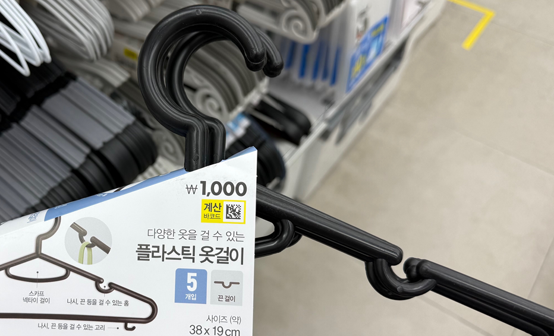

# 7주차 재진열 로봇 예산 및 그리퍼 설계 검토

| 항목 | 내용 |
| --- | --- |
| **회의 일시** | 2026년 10월 12일(월) 16:30 ~ 18:00 |
| **회의 장소** | 오프라인 (수업 중) |
| **참석자** | 박상원, 곽민지, 김민서, 유지원, 윤대준 |

---

## 1. 예산 및 주요 구성

총예산 **120만 원**을 기준으로 다음 항목의 비용을 조사한 뒤 배분하기로 했다.

| 항목 | 검토 내용 |
| --- | --- |
| 프레임 | 재진열 동작을 수행할 구조 및 제작 비용 |
| 그리퍼(재진열) | 랙·피니언 구조 적용 및 부품·제작 비용 |
| 바퀴·구동부 | 전체 무게를 줄이는 방향으로 구성 |
| 기타 | 원형 행거, 옷걸이 등 시연에 필요한 물품 |

- 랙·피니언 구조의 구매 또는 제작 비용 조사가 필요하다.
- **항목별 예산 배분은 비용 조사 후 결정한다.**

---

## 2. 바퀴 및 조향 구조

- 본체 중앙에 조향각을 조절하기 위한 모터 2개(서보 모터)를 배치하는 구조를 검토한다.
  - 중간 기둥의 중앙부에 가깝게 배치한다.
- 본체 끝부분에 바퀴 4개를 배치하는 방안을 검토한다.
- 구동부의 무게를 줄이는 방향으로 설계한다.

---

## 3. 그리퍼 및 옷걸이 받침 설계

### 옷걸이 턱 받침

- 옷걸이를 지지할 턱 받침의 위치를 실험으로 확인한다.
- 받침을 그리퍼의 고정 부분(집게 1) 또는 이동 부분(집게 2) 중 어디에 부착할지 비교한다.
- 그리퍼가 옷걸이를 잡아서 이동하지만, 재진열 동작 때에는 그리퍼와 턱에 걸려서 이동하도록 한다.
- 턱에 걸고 빠지는 과정에서 간섭 없이 분리될 수 있는 구조를 구상해 온다.

### 그리퍼 모델링 및 모터 고정

- 그리퍼 모델링이 필요하다.
- 모터 치수를 기준으로 고정용 소켓을 설계한다.
  - 윗면에 부착 / 아랫면에 부착
- 모터를 탈착할 수 있도록 고정 방식을 검토한다.
- 모터의 장착 위치와 주변 부품 간 간섭을 확인한다.

---

## 4. Fusion 및 애드온 활용

- Fusion에서 사용할 모터의 모델 또는 치수를 반영하여 주변 구조를 설계한다.
- 평기어 생성 애드온과 오픈소스를 활용하는 방안을 검토한다.
- 생성한 평기어를 필요한 형태로 수정하여 적용할 수 있는지 확인한다.
- 퓨전에서 우리의 모터를 가져와서 그것을 기반으로 설계한다.

---

## 5. 옷걸이 및 원형 행거 후보

### 옷걸이 선정 기준

- 그리퍼가 잡을 수 있는 일자 부분이 길고 접촉 면적이 충분한 형태
  - 옷이 흘러내리지 않는 논슬립 형태

- 옷걸이와 옷의 무게를 고려하여 지지 가능 여부를 확인한다.
- 옷걸이의 빠짐 방지 부분이 그리퍼 및 턱 받침 동작에 미치는 영향을 검토해야 한다.

### 옷걸이 후보

| 후보 | 링크 |
| --- | --- |
| 옷걸이 1 | [쿠팡 후보](https://www.coupang.com/vp/products/2270684627?itemId=27087462278&vendorItemId=94055696750) |
| 옷걸이 2 | [다이소 후보](https://www.daisomall.co.kr/pd/pdr/SCR_PDR_0001?pdNo=1010289&recmYn=N) |

### 원형 행거 후보

| 후보 | 메모에 기록된 정보 | 링크 |
| --- | --- | --- |
| 원형 행거 1 | 높이 130, 지름 75 — 단위 확인 필요 | [쿠팡 후보 1](https://www.coupang.com/vp/products/8488876670?vendorItemId=91581188850) |
| 원형 행거 2 | 24,500원 | [쿠팡 후보 2](https://www.coupang.com/vp/products/8825748669?itemId=25717696392&vendorItemId=93410314516) |

※ 가격과 규격은 회의 메모 기준이다.

### 옷

- 당근 마켓 등에서 나눔 의류를 받을 예정이다.
- 저렴한 의류 구매도 고려한다.

---

## 6. 다음 회의까지 준비할 사항

- 프레임·그리퍼·구동부·행거의 예상 비용 조사 및 예산 배분안 작성
- 랙·피니언 구조의 구매·제작 비용 조사
- 모터 치수 및 모델 파일 확보
- 모터 탈착이 가능한 소켓과 장착 위치 구상
- 옷걸이 턱 받침의 부착 위치 비교 및 테스트
- 옷걸이를 턱에 걸고 분리하는 동작의 구조 스케치
- Fusion 평기어 애드온 및 오픈소스 활용 가능 여부 확인 ✅
- 후보 옷걸이와 원형 행거의 규격·무게·가격 확인 ✅

---
