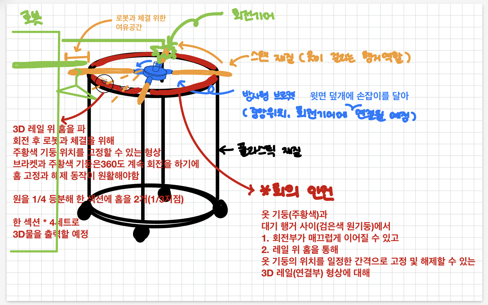

# 1116(월): 회의1 (수업중)_업로드 버전

| 항목 | 내용 |
| --- | --- |
| **회의 일시** | 2026년 11월 16일(월) 16:30~17:10 |
| **회의 장소** | 캡디실, 대면 회의 |
| **참석자** | 박상원, 곽민지, 김민서, 유지원, 윤대준 |

## 1. 제작 및 검증 목표

| 시기 | 항목 | 작업 내용 |
| --- | --- | --- |
| 이번 학기 | 물체 인식 | 인식 기능을 구현 |
| 이번 학기 | 그리퍼 | 리니어 구동 구조를 검토한다. 3점 지지형 그리퍼는 실제 옷을 걸어 파지 상태를 확인한 뒤 구조를 확정한다. |
| 이번 학기 | 옷걸이 이송 | 대기 행거에서 옷걸이를 인출하고 이송하는 동작을 시험한다. |
| 이번 학기 | RFID·본체 | RFID 판독을 시험한다. 장착 높이를 확정한 뒤 본체 설계에 반영한다. |
| 다음 학기 | 이동 구동부·자율주행 | 이동 구동부와 자율주행 기능을 개발한다. |

## 2. 원형 대기 행거 구조 검토(지난 회의 안건)

### 2-1. 김민서: 상부 덮개와 로봇 체결부

- 덮개는 사분면마다 한 장씩 배치한다. **덮개 경계를 링 이음매 사이로 옮겨** 이음매가 덮개 가운데 아래에 오도록 한다.
- 투명 덮개 개념도에는 내부 링, 이음매, 링을 잡는 진한 초록색 클립을 표시한다. 회전 창살과 덮개 사이에는 **약 3 mm 간격**을 두는 안을 검토하고, 조립 후 회전 중 간섭을 확인한다.

[round_hanger_center_bearing_full_3d.html](assets/2026-11-16/round_hanger_center_bearing_full_3d.html)

- 로봇과 행거의 **체결 접촉면에 고무 패킹**을 적용해 미끄러짐을 줄이는 방안을 검토한다.

### 2-2. 유지원: 리브 보강 받침대 제안

레일 이음부는 기존 플라스틱 링과 기둥 상단을 감싸는 **3D 출력 브라켓**으로 받친다. 넓은 곡면 받침은 레일 하중을 링으로 전달하고, 삼각 리브는 받침판의 휨을 줄인다.

### 2-3. 레일 A·B · 계단형 반턱과 U홈

로봇 앞 고정 레일 A·B는 **계단형 반턱으로 연결해 윗면 높이를 맞춘다.** 이음부 상면의 **U홈**은 회전 봉의 정지 위치를 잡는다.

| 설계 요소 | 선정 목적 | 구조와 역할 |
| --- | --- | --- |
| **레일 A·B 반턱 이음** | 단차와 상하 유격 억제 | 두 레일 끝을 겹쳐 윗면 높이를 맞추고 공통 받침 위에 놓는다. |
| **U홈** | 회전 봉 안착 위치 확보 | 봉의 정지 위치를 잡고, 옷걸이를 인출할 때 봉이 원주 방향으로 밀리는 것을 줄이도록 한다. |
| **암수 키** | 레일의 원주 방향 밀림 방지 | 브라켓 돌기와 레일 밑면 홈을 맞물려 A·B 사이가 벌어지는 것을 억제한다. |
| **은색 볼트와 내부 너트** | 레일 들뜸 방지 | 받침 아래에서 레일 내부 너트에 체결해 레일을 받침에 밀착시킨다. |
| **상부 곡면 받침과 삼각 리브** | 접촉 하중 분산 및 받침판 휨 감소 | 넓은 곡면으로 하중을 링에 전달하고, 삼각 리브로 받침판과 링을 감싸는 벽을 연결한다. |
| **하부 클램프** | 브라켓 전체의 원주 방향 밀림 방지 | 상부 받침에 볼트로 체결하고, 기둥 양옆에 맞닿아 브라켓이 링을 따라 움직이는 것을 막는다. |

[w12_rail-bracket-meeting-proposal.html](assets/2026-11-16/w12_rail-bracket-meeting-proposal.html)

## 3. 시험 계획 제안

| 시험 | 방법 및 기록 항목 |
| --- | --- |
| **U홈 안착·옷걸이 인출** | 옷을 건 회전 봉이 U홈 바닥에 실제로 닿는지 확인한다. 옷걸이를 인출할 때 봉이 밀려 홈에서 빠지는지 관찰한다. |
| **모터 구동 이탈** | 모터를 좌우로 각각 구동해 봉이 양방향으로 U홈을 빠져나올 수 있는지 확인한다. |
| **반복 회전** | 반복 회전 전후에 같은 위치에서 레일 A·B 이음부의 **틈과 단차**를 측정해 변화량을 비교한다. |
| **플라스틱 링 하중 시험** | 이음부 외 구간의 **링 처짐과 허용 하중**을 별도로 확인한다. |

## 4. 내일 할 일 · 11월 17일(화)

- **전시 상영용 영상 시나리오 초안 작성**.
    - 최종 완성 시 로봇이 의류를 처리하는 모습을
        
        장면별로 구성한다. 
        
    - 영상은 **3분 이내**로 기획하고
        
        대사와 내레이션은 최소화한다.
        
- 영상 제작 도구 후보를 검토한다:
    
    **Kling AI**, [Gemini](https://gemini.google/overview/video-generation/), [Dreamina](https://dreamina.capcut.com/ko-kr/)
    

## 5. 공지사항: 12월 1일(화) 캡스톤 발표회

| 구분 | 시간 | 내용 |
| --- | --- | --- |
| **전시** | 13:00~16:00 | 기존조는 작품을 전시하고, 신규조는 최종 목표를 담은 영상을 전시장에서 상영한다. |
| **발표** | 16:30~18:00 | 신규조 → 기존조 순서로 발표한다. 신규조 발표도 평가에 반영된다. |
- **발표 자료**에는 현재까지의 진행 과정과
    
    향후 제작과 시험 계획을 담는다.
    
- 발표와 전시 자료에는 고해상도 이미지를 사용한다.
    
    향후 기존조 전시 패널 제작 시에는 인쇄 일정을 고려해 초안을 미리 준비한다.
