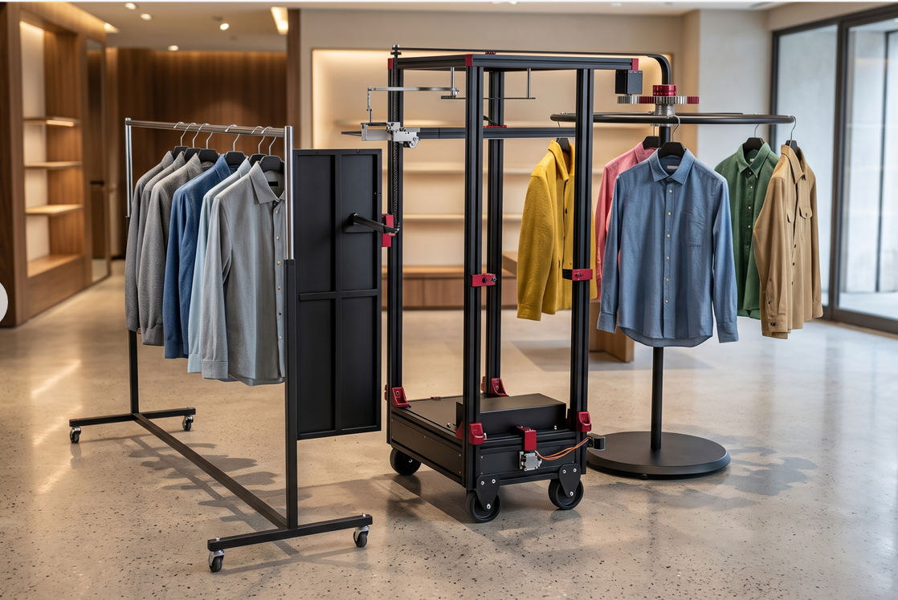
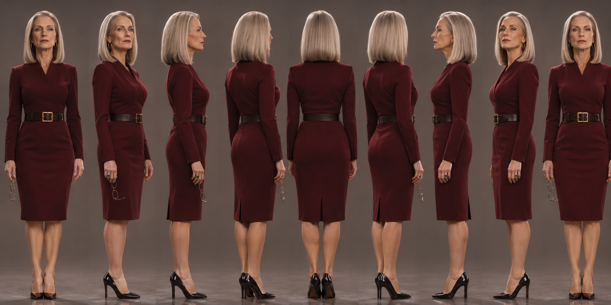

# 1123~1124: 13주차 영상회의 (장면 분담 및 공통 프롬포트 확정)

| 항목 | 내용 |
| --- | --- |
| **회의 일시** | 2026년 11월 23일(월) ~ 24일(화), 수업중 |
| **회의 장소** | 오프라인, 캡디실 |
| **참석자** | 박상원, 곽민지, 김민서, 유지원, 윤대준 |

### 1. 회의 목표 및 확정 사항

- **영화 예고편 형식을 빌린 &HANGERWAY 캡디 발표영상(약 2분 20초)을 제작한다.**
- 이야기의 축은 단순한 기능 소개뿐만아니라
  자동화 도입을 통한 문제의식과 기대효과도 드러낸다.
- 장면은 **로봇팀 / 인물팀**으로 나눠 생성하고, 모든 장면에 **공통 프롬프트**를 적용한다.

### 2. 영상 구성
- 영상의 스토리보드는 민서의 스토리를 확정되었다. 
- 전체 영상을 10초씩 컷을 나눠 분담하여 생성한다.

### 3. 장면별 역할 분담

| 구분 | 담당 장면 | 비고 |
| --- | --- | --- |
| **로봇팀** | 1, 7, 8, 9, 10, 11 | 12는 11과 이어지는 부분까지 로봇팀이 생성 |
| **인물팀** | 2, 3, 4, 5, 6, 12, 13 | 5는 로봇 등장 전까지 인물팀, 이후는 로봇팀 / 12는 미란다가 나오는 이후 부분을 인물팀 |
| **제작 생략** | 14 | 5초 영상이며 13의 마지막 장면과 같으므로 따로 제작하지 않는다 |

**경계 장면 정리**

| 장면 | 앞부분 | 뒷부분 |
| --- | --- | --- |
| **5** | 인물팀 (로봇 등장 전) | 로봇팀 (로봇 등장 후) |
| **12** | 로봇팀 (11과 이어지는 부분) | 인물팀 (미란다 등장 부분) |


### 4. 영상 생성 시 첨부할 레퍼런스

| 구분 | 자료 | 적용 대상 |
| --- | --- | --- |
| **로봇·행거** | 최신 로봇·행거 실사화 이미지 (`assets/2026-11-23_11-24/ref_robot.png`) | 로봇, 원형 대기 행거, 목적지 행거 |
| **인물** | 최신 MIRANDA 360도 전신 참조 시트 (`assets/2026-11-23_11-24/ref_miranda.png`) | 미란다 |
| **매장** | 기존 영상 매장 스크린샷 | 부티크 배경 |
| **동작·구도** | 기계 동작 시뮬레이션 영상, 콘티 영상 등 | 동작 순서, 카메라 연출 |





### 5. 공통 프롬프트 작성 규칙

모든 장면 프롬프트에는 아래 다섯 항목을 **각각** 넣는다.

| 항목 | 내용 |
| --- | --- |
| **TOP PRIORITY** (최우선 지시사항) | 원본 영상의 구도·타이밍·동작·카메라를 유지한 채 실사 패션 필름으로 변환, 타이포는 그대로 유지 |
| **REFERENCE PRIORITY** (레퍼런스 적용 기준) | 레퍼런스는 지정된 대상에만 적용, 충돌 시 최신 승인 이미지 우선, 영상은 동작만 결정 |
| **CONSISTENCY** (일관성 유지 조건) | 촬영·색감, 매장, 로봇 시스템, 인물 외형을 모든 장면에서 동일하게 유지 |
| **NEGATIVE CONSTRAINTS** (생성 금지 조건) | 불필요한 인물·소품·부품, 재디자인, 비현실적 동작, 새 텍스트·로고 금지 |
| **SCENE-SPECIFIC INSTRUCTIONS** (장면별 추가 지시사항) | 장면 번호, 등장 대상, 동작 단계, 표정, 대사 여부 |

**블록 구성:** 아래 블록 중 장면에 필요한 것만 넣는다.

| 블록 | 사용하는 컷 |
| --- | --- |
| 00 TASK | 항상 맨 앞 |
| 01 STYLE | 항상 (인물·로봇 묘사 없음) |
| 02 BOUTIQUE | 매장이 보이는 컷 |
| 03 ROBOT SYSTEM | 로봇이나 전용 행거가 보이는 컷 |
| 04 CHARACTER COMMON | 사람·마스코트가 나오는 컷 |
| 05 MIRANDA | 미란다가 나오는 컷 |

### 6. 다음 할 일

- [ ]  **로봇팀:** 장면 1, 7, 8, 9, 10, 11 및 5·12의 로봇 파트 생성
- [ ]  **인물팀:** 장면 2, 3, 4, 6, 13 및 5·12의 인물 파트 생성 
- [ ]  타이포·크레딧·엔딩 PNG 정리 후 편집 

### 7. 통합 프롬프트

장면별로 `[SCENE-SPECIFIC INSTRUCTIONS]`만 바꿔서 사용한다.

<details>
<summary><b>[TOP PRIORITY]</b> 최우선 지시사항</summary>

```
[TOP PRIORITY]
Transform the provided reference video into a photorealistic live-action cinematic fashion film while faithfully preserving its original composition, timing, action sequences, mechanical movements, and camera direction.
Keep every title, title card, tagline, step label, subtitle, and caption that already appears in the reference video exactly as it is: same wording and characters (including Korean), spelling, font style, size, color, position, and timing. Do not translate, rewrite, misspell, blur, or remove them. Only the picture behind and around the text becomes photorealistic live action; the text stays a crisp, clean graphic overlay. Title cards on a plain dark background keep their dark background, with at most a subtle cinematic film texture.
Prioritize reference accuracy, photorealism, and visual continuity over creative reinterpretation.
```

</details>

<details>
<summary><b>[REFERENCE PRIORITY]</b> 레퍼런스 적용 기준</summary>

```
[REFERENCE PRIORITY]
- Apply each reference image only to its designated subject (boutique, robot system, or a specific character).
- If a visual conflict occurs, the latest approved reference image for that subject takes priority over older images and written descriptions.
- Robot and racks: the latest photorealistic mechanical reference image (straight destination rack on the left, HangerWay robot in the center, circular waiting rack on the right) is definitive for appearance, materials, colors, proportions, and mechanical arrangement. It overrides older illustrations, CAD renderings, simulation models, and conflicting text.
- MIRANDA: the latest 360-degree full-body reference sheet with shoulder-length silver platinum-blonde hair is definitive. Do not use older short-haired references.
- Boutique: follow the established boutique reference image and the previously generated fashion-film footage.
- The reference video determines only movements, action sequences, functional behavior, and camera direction; it never redesigns the established appearance of any subject.
- Do not reproduce reference-sheet layouts, multi-view turntable presentations, or studio/background interiors from any reference image.
```

</details>

<details>
<summary><b>[CONSISTENCY]</b> 일관성 유지 조건</summary>

```
[CONSISTENCY]
Style: cinematic fashion-film trailer look, 2.39:1 framing inside a 16:9 frame, shot on 35mm film, shallow depth of field, brisk editing rhythm, subtle film grain. Palette: black, ivory, warm beige, champagne gold, bronze, selective crimson-red accents. Soft cinematic key light, warm golden architectural lighting, subtle floor reflections, physically accurate shadows. Warm, slightly golden grade matching the previous footage in every scene. Steady, controlled camera. A sophisticated luxury fashion film, not a commercial or tech demo.

Sound: natural ambient sound only unless dialogue is specified. No generated background music. Dialogue only when specified, in natural American English, with a consistent voice per character.

Boutique: a realistic, moderately compact contemporary high-end boutique. Warm beige and ivory wall panels; champagne-gold and bronze framing; long brass garment rails with natural light-brown wooden hangers; illuminated shelves with handbags and accessories; warm golden linear LED lighting; polished warm-beige floor. Racks densely hold tailored jackets, coats, and blazers in black, charcoal, navy, white, ivory, beige, and occasional crimson. Fitting room in the same materials, with dark brown curtains and a collection area by the entrance that may hold disorganized returned garments before automation begins. Keep the same architecture and layout in every shot; different angles show the same physical store.

Robot (about 150 cm tall, 85 cm wide): open rectangular matte-black aluminum-extrusion frame; crimson-red brackets and connectors; black overhead linear rail with a curved end, fixed to the frame; silver rack-and-pinion parts; compact silver hanger gripper on a moving carriage with a three-point grip; small UHF RFID reader near the gripper; tall matte-black sliding pusher panel joined to the body by a black horizontal linkage; low black chassis with battery enclosure and black wheels; small exposed cables; red-and-silver gear coupling to the waiting rack. A realistic functional engineering prototype.

Waiting rack (circular, docked at the robot's rear): wide flat matte-black base, one slim black central pole, rounded black circular top rail, red-and-silver gear coupling above the pole. Black hangers with silver hooks holding garments in muted blue, mustard yellow, dusty pink, dark green, and beige. Only the upper structure rotates, step by step, and stops at the selected hanger; base and pole stay still.

Destination rack (straight, in front of the robot): one silver rail on two slim posts (silver upper, matte-black lower), rectangular black floor frame with two stabilizing feet and small casters. Black hangers with silver hooks holding garments in gray, charcoal, muted blue, and light gray. Stays stationary.

Arrangement: destination rack LEFT, robot CENTER, waiting rack RIGHT. The pusher panel faces the destination rack. Other camera angles show this same arrangement. Dedicated racks (black hangers) stay distinct from brass boutique racks (wooden hangers). The waiting rack supplies garments; the destination rack receives them.

Operation steps (perform only those the scene asks for):
- IDENTIFY: the RFID reader identifies the garment by its hanger tag; the waiting rack rotates to align that hanger with the gripper.
- PICK: the gripper grips the hanger; the carriage carries it along the fixed rail.
- TRANSPORT: the robot carries the garment to the destination rack; it hangs with natural gravity.
- MAKE SPACE: the pusher panel extends and separates the hung garments to open a gap.
- REHANG: at the rail's end the hanger rotates, the hook is placed on the destination rail, and the gripper releases only once it is securely supported.

Characters: original fictional people who resemble no real actor or public figure. Each keeps the same face, age, hair, makeup, wardrobe, accessories, and proportions in every shot. Photorealistic, natural skin texture; subtle, believable expressions; each character appears once per scene, only when required.

MIRANDA: elegant senior boutique manager in her early to mid-60s; authoritative, composed, quietly intimidating. Slender, slightly angular face, sharp blue-gray eyes, subtle dark eyeliner, muted deep rose-red lipstick, natural age lines. Sleek, straight, shoulder-length silver platinum-blonde long bob with a subtle side part. Fitted long-sleeved knee-length deep burgundy dress with V-shaped overlapping neckline, wide dark brown leather belt with rectangular gold buckle, gold hoop earrings, emerald-green ring, glossy black pointed stilettos; may hold thin-framed reading glasses. Upright posture, slow measured steps. Low, calm, elegant voice; never shouts.
```

</details>

<details>
<summary><b>[NEGATIVE CONSTRAINTS]</b> 생성 금지 조건</summary>

```
[NEGATIVE CONSTRAINTS]
- No characters, props, furniture, or mechanical parts beyond what the scene requires.
- No new on-screen text; no watermarks, commercial logos, or brand names.
- No cartoon or anime rendering, CGI-like plastic textures, excessive neon, or theatrical lighting; no camera shake.
- Boutique: no palace-like architecture, oversized chandeliers, excessive marble, empty retail halls, futuristic, industrial, or shopping-mall interiors; no changes in store layout between shots.
- Robot: no redesign, resizing, or simplification; no robotic arms, humanoid features, screens, faces, decorative lights, or protective covers; no detached, floating, or transforming parts; the rail stays fixed, the pusher panel stays attached, the hanger rotates only at the end position.
- Waiting rack: no exposed snowflake structure or protruding radial arms, no extra wheels, poles, or shelves; it never spins, shakes, or dries clothing.
- Destination rack: never a wall-mounted brass rail, wooden rack, circular rack, or boutique furniture; never swap rack functions.
- No floating or disappearing garments; no impossible movements.
- Characters: no duplicates, no changes in age, hair, or wardrobe, no distorted faces, no skin smoothing or beauty filters, no exaggerated expressions. MIRANDA: never a short pixie cut, curls, or ponytail; no other jewelry or handbag.
```

</details>

<details>
<summary><b>[SCENE-SPECIFIC INSTRUCTIONS]</b> 장면별 추가 지시사항</summary>

```
[SCENE-SPECIFIC INSTRUCTIONS]
Scene number: (e.g., 8)
Subjects in shot: (boutique / robot system / MIRANDA / ...)
Operation step: (IDENTIFY / PICK / TRANSPORT / MAKE SPACE / REHANG / none)
Expression: (NEUTRAL / THINKING / GIVING INSTRUCTIONS / DISSATISFIED / EVALUATING THE ROBOT / SATISFIED)
Dialogue: (none, or the exact line)
Additional notes: (camera angle, framing, timing)
```

</details>
